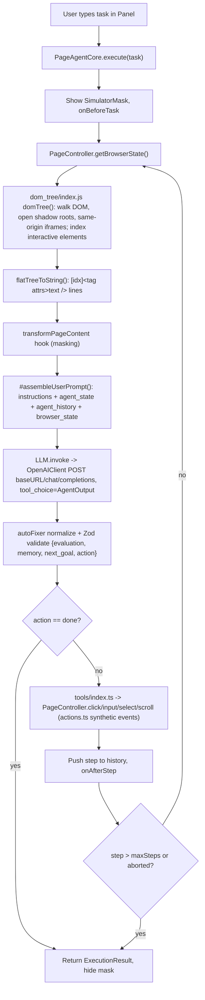

# page-agent evaluation findings

Evaluated: upstream `alibaba/page-agent` at `upstream/main` = `9eb6b66` ("chore(version): bump version to 1.12.4", 2026-09-06). Evaluation date: 2026-10-17.

## 1. Decision block

```
RECOMMENDATION: CONDITIONAL
CONFIDENCE: medium
ONE-LINE REASON: page-agent solves the real "20-click form/config workflow" problem for a web app you own and it works with any OpenAI-compatible, self-hostable model, but it has one maintainer, open security reports that nobody has answered, and only prompt-level guardrails, so the demo should run on a lower-risk internal tool and not on customer-facing PMA.
CONDITIONS: (1) Run the demo on an internal tool or on a PMA staging tenant with synthetic data only, with no customer data and no production Keycloak realm; (2) send LLM traffic through a same-origin backend proxy (customFetch + session cookie) to an enterprise-contracted or self-hosted model, and never use the free demo LLM or the CDN demo bundle; (3) keep experimentalScriptExecutionTool off, and do not install the Chrome extension or the MCP server; (4) put destructive controls in interactiveBlacklist / data-page-agent-not-interactive and wrap write actions in a code-enforced confirmation (custom tool or onBeforeStep hook), because prompt instructions alone are not enforcement; (5) log every step (history incl. rawRequest/rawResponse) server-side through the proxy.
RECOMMENDED MODEL FOR DEMO: OpenAI gpt-5.4-mini (one of the starred "baseline" models in the docs) on the company's enterprise OpenAI-compatible gateway (e.g. Azure OpenAI or an internal LiteLLM gateway), called as /chat/completions with tool calling through a same-origin backend proxy; a second leg runs a self-hosted open-weight Qwen model (e.g. qwen3.8-27b) on vLLM's OpenAI-compatible server to prove the self-hosted path.
PINNED VERSION: 1.12.4
```

## 2. Summary

- page-agent is an MIT-licensed TypeScript library that you add to your own web app (script tag or `npm i page-agent`). It turns a natural-language request into a series of clicks, typing and scrolling on the live page.
- Instead of screenshots it reads the DOM as indexed text, so a text-only model is enough, and it calls any OpenAI-compatible `/chat/completions` endpoint with tool calling, including self-hosted ones.
- It is for product teams that want to ship an in-app copilot ("configure this for me", "fill this form") without a backend rewrite or a headless browser.
- It replaces hand-written UI tours or wizards, brittle RPA/Selenium-style macros for end users, and server-side browser agents (browser-use) when the app is yours and the user is already logged in.
- It does not replace an API/MCP layer for data access, and it cannot read charts.

Fork status: `singhrohit90/page-agent` is **0 commits behind** `upstream/main` and **1 commit ahead**. That commit is `5adb724` "Add page-agent evaluation orchestrator and sub-agents" and only touches `.claude/` and `.gitignore`, with no product code. (The local clone is shallow. The count comes from `git rev-list --count HEAD..upstream/main` = 0 and `upstream/main..HEAD` = 1.)

## 3. Problem

The pain: enterprise web apps (PMA included) have workflows that take many clicks spread across nested forms, tabs, dialogs and dropdowns. Examples are setting up a data source, building a dashboard filter set, configuring alert thresholds, or creating a station/line mapping. Users who do these rarely forget the path, support teams then write step-by-step guides, and product teams build wizards one at a time.

Existing options and why they fall short for "an assistant inside my own app, acting as the logged-in user":

| Approach | Why it falls short here |
|---|---|
| Manual multi-click workflows + docs | This is the problem itself. Docs go stale and support load grows with UI complexity. |
| Selenium / Playwright scripts | These are written by engineers for fixed paths and break when the UI changes. They run outside the user's browser, so they need their own login/session (a Keycloak login flow plus MFA). They are test/automation tools, not end-user features. |
| RPA (UiPath etc.) | Desktop or bot runtime, licence cost, selector maintenance, built for back-office batch work, not for an interactive copilot inside a SaaS UI. |
| browser-use (Python) | A good general agent, but it drives a separate Chromium over CDP from a Python backend. It needs server infrastructure and a separate authenticated browser session per user. It suits automating third-party sites, not shipping a feature in your own frontend. page-agent's DOM serializer and prompt come from browser-use (README acknowledgment, `packages/core/src/tools/index.ts` header "Adapted from browser-use"). |
| Screenshot computer-use agents | They need a vision model, every step costs image tokens, latency is higher, and they need a VM or remote browser. Clicking by pixel coordinates is less precise than clicking a DOM element by index. |

page-agent's bet: if the agent lives in the page, it inherits the user's session, sees the DOM directly, and needs no backend except an LLM endpoint.

## 4. How it works

All paths below are relative to the repo root.

**Step 0: construction.** `new PageAgent(config)` (`packages/page-agent/src/PageAgent.ts`, class `PageAgent`) creates a `PageController` with `enableMask: true` by default, calls `PageAgentCore`'s constructor, and attaches the UI `Panel`. `PageAgentCore` constructor (`packages/core/src/PageAgentCore.ts`) creates the `LLM` client, copies the built-in tool map, merges `customTools` (a `null` value removes a tool), and deletes `execute_javascript` unless `experimentalScriptExecutionTool` is set. Default `maxSteps` is 40.

**Step 1: task start.** `PageAgentCore.execute(task)` resets history, creates an `AbortController`, removes `ask_user` if no `onAskUser` is set (the Panel sets one in `packages/ui/src/panel/Panel.ts`), shows the `SimulatorMask` overlay that blocks user input, and runs `onBeforeTask`.

**Step 2: observe (DOM extraction).** For each step, `PageController.getBrowserState()` (`packages/page-controller/src/PageController.ts`) calls `updateTree()`. That calls `dom.getFlatTree()` (`packages/page-controller/src/dom/index.ts`), which runs the browser-use-derived extractor `domTree()` in `packages/page-controller/src/dom/dom_tree/index.js`:
- It walks the DOM, including open shadow roots (`node.shadowRoot`) and same-origin iframes (`node.contentDocument`). Cross-origin iframes throw and are skipped with `console.warn('Unable to access iframe')`.
- `isInteractiveElement()` decides what is interactive from tag type, ARIA roles/attributes, and computed `cursor` style (pointer etc.). `isTopElement()` uses `elementFromPoint` to drop occluded elements.
- `isElementAccepted()` has a leaf deny list that includes `svg`, `script`, `style`, so SVG content is never serialized.
- Each accepted interactive element gets a numeric `highlightIndex`, and a highlight overlay is drawn. Elements not seen before are flagged `isNew`.
- `interactiveBlacklist` / `interactiveWhitelist` config and the `data-page-agent-not-interactive` attribute remove elements from or add elements to the indexed set.

**Step 3: serialize to text (dehydration).** `dom.flatTreeToString()` turns the tree into lines like `[12]<button aria-label=Save>Save />` with tab indentation for nesting, `*[n]` for new elements, and plain text lines for visible non-interactive text. Only a fixed attribute allowlist is kept (`title, type, checked, name, role, value, placeholder, aria-*, id, for, target, contenteditable ...`), values are capped at 20 chars, and scrollable containers get `data-scrollable="top=.., bottom=.."`. `getSelectorMap()` keeps the index-to-element map for later actions. `getBrowserState()` wraps the result with a header (title, URL, viewport/page size, pages above/below) and a footer.

**Step 4: build the prompt.** `#assembleUserPrompt()` in `PageAgentCore.ts` creates one fresh user message per step containing:
- optional `<instructions>` (`instructions.system`, `instructions.getPageInstructions(url)`, optional `/llms.txt`)
- `<agent_state>` with the user request and step counter
- `<agent_history>`: a compressed list of each prior step's evaluation / memory / next_goal / action result plus `<sys>` observations (URL changes, wait warnings, "5 steps remaining")
- `<browser_state>`: the dehydrated page, optionally passed through `transformPageContent` (the data-masking hook)

The system prompt is `packages/core/src/prompts/system_prompt.md` (a browser-use derivative). The conversation is not carried forward, so each call sends the system prompt, the condensed history and the full current page.

**Step 5: think (LLM call).** `#packMacroTool()` merges every tool into one "MacroTool" named `AgentOutput`. Its schema is `{evaluation_previous_goal, memory, next_goal, action: union-of-tools}`, so the model has to reflect before it acts. `LLM.invoke()` (`packages/llms/src/index.ts`) wraps `OpenAIClient.invoke()` (`packages/llms/src/OpenAIClient.ts`) with retries (default 2). That client POSTs to `${baseURL}/chat/completions` with `tools`, `parallel_tool_calls: false` and a named `tool_choice` (unless `disableNamedToolChoice`). It sends `Authorization: Bearer apiKey` when a key is set, and it uses `customFetch` when provided. `modelPatch()` (`packages/llms/src/utils.ts`) adjusts the request per model family (Qwen, DeepSeek, GPT, Claude, Gemini, GLM, Hunyuan, Grok), for example turning thinking off or rewriting `tool_choice` for Claude. The response is checked for `finish_reason`, repaired by `normalizeResponse` (`packages/core/src/utils/autoFixer.ts`), JSON-parsed and validated with Zod. Errors are typed (`packages/llms/src/errors.ts`).

**Step 6: act.** The MacroTool's `execute` looks up the chosen tool in `packages/core/src/tools/index.ts`: `click_element_by_index`, `input_text`, `select_dropdown_option`, `scroll`, `scroll_horizontally`, `wait`, `ask_user`, `done`, and the opt-in `execute_javascript`. These call `PageController` methods, which call `packages/page-controller/src/actions.ts`:
- `clickElement()` dispatches a synthetic pointer/mouse event sequence, focuses the element, and calls `.click()`.
- `inputTextElement()` uses the native value setter plus `beforeinput`/`input`/`change` events, so React/Angular bindings pick up the change. `patches/react.ts` and `patches/antd.ts` add framework-specific fixes.
- `selectOptionElement()` works only on native `<select>`.
- `executeJavascript()` runs `eval()` on the model's code.

Each action returns a text result (for example "Clicked element ([12]<button>Save />)"), and that text goes into the next step's history.

**Step 7: terminate.** The loop ends when the model calls `done` (`success` + `text`), when `step > maxSteps`, on an unrecoverable error, or on `stop()`/`dispose()`. The `finally` block removes highlights, hides the mask and sets the final status (`completed | error | stopped`). `onBeforeStep`, `onAfterStep`, `onAfterTask` hooks and `statuschange` / `historychange` / `activity` events make every step observable.



### Code vs README / docs discrepancies

1. **"By default only elements in the visible viewport are listed"** (system prompt, `browser_rules`) is wrong. `DEFAULT_VIEWPORT_EXPANSION = -1` in `packages/page-controller/src/dom/index.ts`, which means the full page is serialized by default. That is good for recall but costly in tokens on long pages. The code comment admits that values other than -1 and 0 have "no practical use".
2. **"Element Interaction Allowlist/Blocklist"** (docs `advanced/security-permissions`) is about which elements get an index (`interactiveBlacklist` / `interactiveWhitelist`). It is not an action-level policy engine. A blacklisted element is just invisible to the model.
3. **"Requires User Confirmation" for medium-risk operations** (same docs page) works only through natural-language `instructions`. No code path forces confirmation before a click or input. The model may or may not call `ask_user`. An upstream branch `feat/page-controller-action-guards` (last commit 2026-09-11, not merged) adds checks that reject misused actions. It validates action types; it does not add a confirmation gate.
4. **"Works with most mainstream models, including locally deployed ones"** (README) holds only for servers that implement OpenAI `/chat/completions` with function calling. The client sends a named `tool_choice` by default, so servers that reject it need `disableNamedToolChoice: true`. There is no Responses API client (issue #745 requests one) and no native Anthropic/Gemini client. The code reaches them only through OpenAI-compatible shims.
5. **"Everything happens in your web page"** (README) is true for DOM work, but every step sends the page's text and form values to the LLM endpoint. `docs/terms-and-privacy.md` says this clearly. The README headline does not.
6. **Demo bundle defaults to `language: 'zh-CN'`** (`packages/page-agent/src/demo.ts`) even though README examples use `en-US`. This is minor but will surprise a demo audience.
7. `scroll_horizontally` carries the code comment "Tables need a dedicated parser to extract structured data. This tool is useless.", and `extract_structured_data`, `send_keys` and `upload_file` are `@todo`. The tools are thinner than the README's "smart form filling" pitch suggests.

## 5. Concepts likely to be confused

**In-page script mode vs Chrome extension vs MCP server mode**

| Mode | What it is | Who installs it | Scope | Relevance to PMA |
|---|---|---|---|---|
| In-page script (`page-agent` npm / IIFE) | The library runs inside your app's JS bundle, in the same origin and with the same privileges as your code | You, the app owner | Single page/SPA. The system prompt says "You can only handle single page app. Do not jump out of current page." SPA route changes are fine (it detects URL change) | This is the only mode worth evaluating |
| Chrome extension (`packages/extension`, "Page Agent Ext") | A side-panel agent (`MultiPageAgent`) that drives any tab through content scripts. Permissions: `tabs, tabGroups, sidePanel, storage`, host `<all_urls>`, `externally_connectable: http://localhost/*` | Each end user | Multi-tab, any site | Not appropriate for customers. It is a personal power-user tool |
| MCP server (`@page-agent/mcp`, beta) | A Node stdio MCP server exposing `execute_task`, `get_status`, `stop_task`. It opens a localhost HTTP+WS "hub" that the extension connects to | A developer on their own machine | Lets Claude Desktop/Cursor etc. drive the user's real browser via the extension | Different direction from the planned PMA MCP server (see section 10). Has open security reports (#647) |

**DOM-text agent vs screenshot computer use.** page-agent never looks at pixels. It sees what the DOM serializer emits: element tags, a small allowlist of attributes, and visible text. Text-only models are therefore fine and cheap, and clicks hit exactly the intended element. The agent is blind to anything that is not DOM text, such as canvas charts, SVG marks, images, and visual layout or state shown only by color. Screenshot agents (Anthropic computer use, OpenAI CUA-style) see pixels, so they can read a chart, but they need a vision model, spend image tokens on every step, click by coordinates, and need a VM or browser runtime.

**page-agent vs a normal chatbot widget.** A chatbot widget answers questions from its own knowledge or RAG and does not touch the UI. page-agent operates the UI: it clicks and types as the logged-in user and can change data. It is not a Q&A system. Its only "answer" channel is the `done.text` string, and it can only answer from what is visible in the DOM. A PMA support agent that answers analytics questions is a different product (see section 10).

## 6. Comparison table

| | page-agent | browser-use | Playwright MCP | Screenshot computer use (e.g. Claude computer use) |
|---|---|---|---|---|
| Where it runs | Inside the user's tab, as JS in your app | Python process driving a separate Chromium via CDP (local or Browser Use Cloud) | Node MCP server driving a Playwright browser for an MCP client | Agent loop in your backend plus a VM/container or remote browser |
| Needs backend? | Only an LLM endpoint (a proxy is strongly recommended) | Yes (Python runtime, browser infra) | Yes (MCP host + Playwright browser) | Yes (VM/browser + orchestration) |
| Needs multimodal model? | No | No for DOM mode; vision optional | No (accessibility snapshot); screenshots optional | Yes |
| Multi-page support | Same SPA only; multi-tab only via extension | Yes, multi-tab, any site | Yes | Yes, any app |
| Auth/session handling | Inherits the user's live session (Keycloak cookies/tokens) with nothing to set up | Needs its own login or profile/cookie injection | Needs its own login or persisted storage state | Needs its own login inside the VM |
| Rough cost per task | Text tokens only. ASSUMPTION: about 3k-30k input tokens per step depending on page size, 5-15 steps per form task, so roughly 50k-300k input tokens per task, cents on a mini-class model | Similar token profile to page-agent (same lineage); Cloud docs list $0.01/task plus per-step model-dependent cost ([docs.browser-use.com/cloud](https://docs.browser-use.com/cloud)) | Widely cited about 114k tokens/task, about $0.34 on Sonnet, vs about 27k with Playwright CLI ([playwright.aims-ai.com](https://playwright.aims-ai.com/blog/playwright-cli-vs-mcp-server-token-cost)); one source, not independently confirmed | Third-party estimate about $1-2 per 50-step session ([omidsaffari.com](https://omidsaffari.com/blog/claude-multi-action-computer-use-cost-2026)); low-quality source |
| Best use case | An in-app copilot for an app you own: forms, configuration, navigation, done as the current user | Automating third-party websites, scraping, back-office web tasks at scale | Developer/agent tooling: testing, letting coding agents check UIs | Apps with no DOM access (desktop, canvas-heavy, legacy), visual verification |

Snapshot vs screenshot trade-off, from Playwright's own docs: snapshots are cheap text and need no vision model, while screenshots cost image tokens ([playwright.dev/mcp/snapshots](https://playwright.dev/mcp/snapshots)).

## 7. Limits and failure modes

| Area | Behavior (code-verified unless marked) | PMA impact |
|---|---|---|
| Canvas charts | Nothing is serialized. `<canvas>` has no DOM text | ECharts/Highcharts-in-canvas/WebGL charts are invisible. The agent cannot read a value or trend |
| SVG charts | `svg` is on the leaf deny list in `isElementAccepted()` (`dom_tree/index.js`), so marks, labels and tooltips inside SVG are dropped | D3/Highcharts SVG charts are also invisible. Chart reading is not possible |
| iframes | Same-origin iframes are traversed. Cross-origin ones fail with a console warning and are skipped | Embedded Grafana/Superset/third-party widgets on another origin are invisible |
| Shadow DOM | Open shadow roots are traversed. Closed shadow roots are not (they cannot be reached from JS) | Angular's default emulated encapsulation is fine. Closed-shadow web components are not |
| Virtualized tables | Only rendered rows exist in the DOM. There is no table extractor (`extract_structured_data` is `@todo`, and the `scroll_horizontally` comment calls it "useless" for tables) | ag-Grid / CDK virtual scroll: the agent sees about 20-50 rows, must scroll and re-read, and cannot reliably aggregate. Bulk data is a poor fit |
| Custom widgets | `select_dropdown_option` only supports native `<select>`. Custom dropdowns need click sequences. Open bugs report misread checkboxes (#722), nested clickable avatars (#720), Ant Design Vue tree-select (#601), select by label vs value (#749), and text input on checkbox/file fields (#747) ([issues list](https://github.com/alibaba/page-agent/issues)) | Angular Material `mat-select`, date pickers and autocompletes will take extra steps and fail sometimes. Test each one |
| Latency per step | Each step is one full LLM round trip plus `stepDelay` 0.4 s plus a 0.5 s wait after navigation. There is no streaming (feature request #662). ASSUMPTION: about 2-8 s per step on a mini-class model, so 30 s to 2 min for a 10-step form | Fine for "do it for me" config tasks. Too slow for anything interactive |
| Token cost on large pages | The full page is serialized every step by default (`viewportExpansion = -1`), and the system prompt is resent each step (no conversation reuse) | Dense dashboards with many filters and grids can produce very large prompts. Use `interactiveBlacklist`, `data-page-agent-not-interactive` on irrelevant regions, or `viewportExpansion: 0` |
| Prompt injection through page content | Visible page text goes into the prompt with no trust separation from instructions, and the system prompt does not tell the model to ignore instructions found in page content. Customer-entered strings (asset names, comments, Jira text pulled into the UI) can hijack the agent. General research on this class of attack: [arxiv 2511.19477](https://arxiv.org/html/2511.19477v1) | In multi-tenant PMA, one user's data shown to an admin is an injection vector |
| Logged-in user's privileges | The agent acts with exactly the user's session. The maintainer's HN reply: it runs "with the same privileges as any other JavaScript on the page" ([HN](https://news.ycombinator.com/item?id=47264138), via search summary) | Anything the user can do, the agent can do, including admin actions for tenant admins |
| Irreversible actions without confirmation | Nothing in code stops a click on Delete/Submit/Approve. Confirmation is prompt-level only. `SimulatorMask` blocks the user from intervening mid-task (they can only stop) | You must enforce it yourself: blacklist destructive controls, use a server-side confirmation, or add a custom tool that requires `ask_user` |
| `execute_javascript` | `eval()` on model output (`PageController.executeJavascript`). Off by default. Open report #643 | Never enable it |
| Determinism | LLM-driven, so a run is not repeatable. Docs warn weak tool-callers return malformed output, partly auto-repaired by `autoFixer.ts` | Not suitable for anything that needs an audit-grade repeatable process |

## 8. Security

**What data leaves the browser and to whom.** On every step `OpenAIClient` POSTs to `config.baseURL` the following: the system prompt, the task text, condensed history, and the serialized page (visible text, form `value` attributes, ids/names, ARIA labels, URL and title). The destination is whatever `baseURL` points to and nothing else. `docs/terms-and-privacy.md` says the library has no backend of its own, no analytics, and that "The HTML cleaning process ... does not guarantee removal of sensitive information". Optional extra egress: `experimentalLlmsTxt` fetches `/llms.txt` from the current origin. `transformPageContent` is the only built-in masking hook and it is regex-on-text that you write yourself.

**Keeping the API key out of client code (proxy pattern).** `apiKey` is optional. Without it no `Authorization` header is sent. The documented production pattern (models docs page, source `packages/website/src/pages/docs/features/models/page.tsx`) is:

```ts
new PageAgent({ baseURL: '/api/llm-proxy', model: 'gpt-5.4-mini',
  customFetch: (url, init) => fetch(url, { ...init, credentials: 'include' }) })
```

For PMA, the proxy should:
- validate the Keycloak session/JWT
- inject the real provider key
- pin the `model` and strip any other one
- enforce max tokens and a per-tenant rate limit
- log request/response with the tenant id and user id
- optionally run server-side PII/tenant-data redaction
- reject requests that contain `execute_javascript` in `tools`

The docs warn in bold: "NEVER commit real LLM API keys to your frontend code".

**Open security reports (upstream, unanswered as of 2026-10-17).** All were filed 2026-07-30 by one reporter, and none had a maintainer comment, label or linked PR when fetched:

- [#643](https://github.com/alibaba/page-agent/issues/643): `eval()` on LLM-controlled input (the opt-in `execute_javascript`). Confirmed in code.
- [#644](https://github.com/alibaba/page-agent/issues/644): extension `window.postMessage(..., '*')` with no `e.origin` check in `content.ts` / `main-world.ts`. Messages can carry the config, including the API key. Confirmed in code: there is no origin check in `packages/extension/src/entrypoints/content.ts`. This is extension-only.
- [#647](https://github.com/alibaba/page-agent/issues/647): plaintext `ws://localhost` hub between the MCP server and the extension carries the API key and tasks. Also, `allowAllHubConnection` in storage skips the approval dialog. Confirmed in code: `packages/mcp/src/hub-bridge.js` does no Origin or auth check on WS connections, and the first client to connect becomes the hub. My own reading, not verified by test: a web page could open `ws://localhost:38401` before the extension does and receive tasks plus LLM config. This is MCP/extension-only.
- #645 (API keys kept in request history and shown in the UI), #646 (non-crypto RNG), and #634 (a private advisory awaiting review). Titles come from the [issues list](https://github.com/alibaba/page-agent/issues). Not individually fetched.

No GHSA/CVE for page-agent turned up in search. `docs/SECURITY.md` defines private reporting and "best-effort" fixes for `main` and the latest release only. Implication: the in-page library (core + page-controller + llms) is the smallest attack surface. The extension and MCP pieces have unanswered reports and should stay out of scope.

**Terms of the free demo LLM** ([docs/terms-and-privacy.md section 2](https://github.com/alibaba/page-agent/blob/main/docs/terms-and-privacy.md)):
- Technical evaluation only, no production use.
- No PII or confidential business data.
- Data is processed through Alibaba Cloud Function Compute in Mainland China (endpoint `page-ag-testing-ohftxirgbn.cn-shanghai.fcapp.run` in `demo.ts`) to Bailian Qwen models.
- They say they do not store or log prompts.
- Can be rate-limited or withdrawn at any time; "AS IS".
- Explicitly not for EU/EEA data-localization regions.

It is also the default in the CDN demo bundle and in the extension's default config. For PMA: never point it at a real PMA page.

**Which supported models can be self-hosted.** The docs list (`packages/website/src/pages/docs/features/models/page.tsx`) covers Qwen, OpenAI, DeepSeek, Google, Anthropic, xAI, Z.AI GLM, Moonshot Kimi, Tencent Hunyuan and MiniMax. Baseline (starred) models: `gpt-5.4-mini`, `gpt-5.4-nano`, `claude-haiku-4-5`, `gemini-3.8-flash`, `deepseek-v4-flash`, `qwen3.5-plus`, `qwen3.5-flash`.
- **Self-hostable (open weights). ASSUMPTION:** these families publish open weights for at least some sizes: Qwen (for example `qwen3.8-27b` in the list; the hosted `-plus/-max/-flash` tiers are API-only), DeepSeek, GLM, Kimi, MiniMax. Serve them with vLLM, which supports `tool_choice` `required` and named functions on its OpenAI-compatible API ([vLLM tool calling docs](https://docs.vllm.ai/en/stable/features/tool_calling/)). Ollama exposes OpenAI-compatible tool calling ([ollama.com/blog/tool-support](https://registry.ollama.ai/blog/tool-support)), but named `tool_choice` support is unclear, so set `disableNamedToolChoice: true`. The README itself recommends Ollama for offline use.
- **Through an OpenAI-compatible endpoint only (not self-hostable):** OpenAI GPT (native), Gemini (Google's OpenAI-compat endpoint), Claude (Anthropic's OpenAI-compat endpoint or a gateway; `modelPatch` converts `tool_choice`), Grok, and Alibaba Bailian Qwen (`dashscope.aliyuncs.com/compatible-mode/v1`). Azure OpenAI uses a different URL/auth shape. ASSUMPTION: you need `customFetch` or the proxy to rewrite path/`api-key` header. A LiteLLM-style gateway avoids that.
- The docs warn that small models or weak tool-callers perform poorly, which limits how small a self-hosted model can be.

## 9. Learning resources

YouTube MCP tools were not available in this session, and web search found **no substantive YouTube video** that demonstrates or critiques page-agent. None are listed. The README's own embedded demo video (GitHub asset) is the only video found. Several third-party domains could not be fetched from this sandbox (DNS blocked), so their rows are marked "(snippet)" and judged from search snippets only.

| URL | Date | One-line summary | Worth my time? |
|---|---|---|---|
| https://github.com/alibaba/page-agent | 2026-09-06 (v1.12.4) | README, quick start, use cases; about 29.5k stars, 52 open issues, 59 open PRs at fetch time | yes |
| https://github.com/alibaba/page-agent/issues/349 | 2026-03-24 | Maintainer note: maintained "primarily on my own, with limited resources", no guaranteed response times, no large AI-generated PRs | yes |
| https://news.ycombinator.com/item?id=47264138 | about 2026-03 (approx., "about 225 days old") | Show HN thread. Main critique (bsenftner): an in-page agent can use and leak session tokens. Maintainer: same privileges as any page JS (snippet) | yes, skim |
| https://github.com/alibaba/page-agent/blob/main/docs/terms-and-privacy.md | 2026-03 | What data leaves the browser; free demo API terms (China, no PII, eval only) | yes |
| https://github.com/alibaba/page-agent/issues/643 , /644 , /647 | 2026-07-30 | Unanswered security reports: eval, postMessage '*', plaintext localhost WS hub | yes |
| https://github.com/alibaba/page-agent/blob/main/docs/CHANGELOG.md | through 2026-07-09 | Release history 1.0.0 (2026-01-19) to 1.12.0; good for API churn (1.10.0 broke the lifecycle API) | yes |
| https://alibaba.github.io/page-agent/docs/introduction/overview | current | Official docs (could not fetch here; read from source at `packages/website/src/pages/docs/`). See Models, Security & Permissions, Data masking, Custom tools | yes |
| https://dev.to/andrew-ooo/alibaba-pageagent-review-ai-agent-inside-your-web-app-3hn8 | 2026 (exact date unknown) | Third-party review: in-app copilot fit; external tools still better for cross-site/multi-tab (snippet) | maybe |
| https://www.webfuse.com/blog/how-to-build-an-ai-support-agent-with-alibaba-page-agent | 2026 (unknown) | Vendor tutorial on building a support agent with page-agent; vendor bias likely (snippet) | maybe, relevant to the support-agent idea |
| https://www.marktechpost.com/2026/07/02/meet-alibabas-page-agent-a-javascript-in-page-gui-agent-that-controls-web-interfaces-with-natural-language-through-the-dom/ | 2026-07-02 | News-style README rehash (snippet) | no |
| https://themenonlab.blog/blog/alibaba-page-agent-in-page-gui-agent | 2026 (unknown) | Overview contrasting it with Playwright; repeats demo-API caveat (snippet) | no |
| https://playwright.dev/mcp/snapshots | current | Official explanation of accessibility snapshot vs screenshot trade-offs | yes, for the comparison |
| https://playwright.aims-ai.com/blog/playwright-cli-vs-mcp-server-token-cost | 2026 | Token cost of Playwright MCP vs CLI (about 114k vs 27k per task) (snippet) | maybe |
| https://docs.browser-use.com/cloud | current | browser-use Cloud pricing model (per task + per step) | maybe |
| https://docs.vllm.ai/en/stable/features/tool_calling/ | current | vLLM tool calling incl. `tool_choice` required/named, needed for the self-hosted path | yes |
| https://arxiv.org/html/2511.19477v1 | 2025-11 | "Building Browser Agents: Architecture, Security, and Practical Solutions": prompt injection and guardrail patterns for browser agents | yes |

## 10. Integration assessment (PMA)

**Verdict: pilot on a lower-risk internal tool first, then (maybe) a PMA staging tenant. Do not integrate into customer-facing PMA now.**

Why not straight into PMA:
- Multi-tenant external customers plus only prompt-level guardrails is a bad combination.
- Every step sends tenant data to an LLM.
- There is a single maintainer, security reports have gone unanswered for about 2.5 months, and the last release was 2026-09-06.
- Chart reading, which is much of what an analytics platform is for, does not work.

Why it is still worth a demo:
- The core library is small, readable and hackable (about 5k lines in the core packages).
- It works with any OpenAI-compatible endpoint, including self-hosted.
- The "configure it for me" problem is real for PMA admins.

Conditions for the pilot:
- Internal tool or PMA staging with synthetic tenant data
- Same-origin LLM proxy validated against Keycloak, enterprise or self-hosted model
- `execute_javascript` off; no extension, no MCP package
- Destructive controls blacklisted
- Code-enforced confirmation on writes
- Server-side step logging

**Workflow fit**

| Fits | Why |
|---|---|
| Forms: alert/threshold setup, report schedules, user invites in an internal admin tool | Native inputs plus a well-labelled DOM is what it is built for |
| Configuration: data-source / station / line mapping wizards, dashboard filter presets | Many clicks, low creativity; the agent saves the user from learning the path |
| Navigation: "take me to the yield report for line 3 last week and set the filters" | SPA route plus filter controls; read-only, so lower risk |
| Guided onboarding / accessibility ("do it for me" for rare tasks) | A documented use case |

| Does not fit | Why |
|---|---|
| Chart reading ("why did yield drop on Tuesday?") | Canvas/SVG are invisible to the serializer |
| Bulk data (export, aggregate, compare across 10k rows) | Virtualized grids, no table extractor, token cost; use APIs instead |
| Cross-application flows (PMA to Jira to email) | Single-page by design; multi-tab needs the extension |
| Anything needing audit-grade repeatability | LLM-driven, non-deterministic |

**Complement or duplicate the planned PMA MCP server and support agent?** Mostly complement, with a small overlap.
- **PMA MCP server** (planned): exposes PMA data and operations as typed tools/APIs to agents. That is the right layer for analytics Q&A, bulk data and chart-backing data, because the model gets numbers rather than pixels or DOM. page-agent's `@page-agent/mcp` does the opposite: it lets an external agent drive a human's browser. It does not duplicate a PMA MCP server and should not be used to build one.
- **Portal support agent** (analytics Q&A plus failure triage with Jira ticketing): Q&A and triage belong to the MCP/API-backed agent. page-agent could be the "hands" of that agent inside the UI. For example, after the support agent decides "set threshold X on station Y", page-agent performs it visibly in the user's session, or navigates the user to the right screen. Wire it through `customTools` (a custom tool that calls the support agent's backend) or through `instructions.getPageInstructions` per Angular route.
- **Overlap risk:** if the MCP server already exposes "set threshold" as an API tool, letting page-agent do the same through the UI creates two write paths with different validation. Prefer API writes, and use page-agent for navigation and for config screens that have no API.

**What must be true before customer data could pass through it**
1. **Model hosting:** a self-hosted or enterprise-contracted model in an approved region, under a DPA that covers customer data. Never the demo endpoint.
2. **Proxy:** all calls go through a PMA backend proxy that validates the Keycloak token, pins model and limits, injects the key, and does no client-side key handling.
3. **Tenant isolation:**
   - The proxy tags every request with tenant and user ids, with no cross-tenant caching or prompt reuse.
   - If a shared self-hosted model is used, either disable prefix caching across tenants or accept it after review (ASSUMPTION: vLLM prefix caching is a theoretical side channel).
   - Masking via `transformPageContent` plus server-side redaction for fields classified as sensitive.
4. **Audit logging:** persist each step (task, serialized page hash or redacted content, action, result, user, tenant, timestamp) through `onAfterStep` plus proxy logs, kept under the platform's retention policy.
5. **Action allowlist:**
   - Mark the agent's operable area explicitly with `interactiveWhitelist` and `data-page-agent-not-interactive` on everything else.
   - Remove `execute_javascript`.
   - Override `click_element_by_index` / `input_text` with custom tools that check a per-route allowlist of element ids.
6. **User confirmation on writes:** a custom tool or `onBeforeStep` hook that pauses before any element marked as a write (Save/Submit/Delete/Approve) and requires explicit user consent, enforced in code. Backend authorization stays the real control: the agent must never be able to do more than the user.
7. **Prompt-injection hardening:** add a system instruction that page text is data, not instructions; keep customer free-text fields out of the agent's scope where possible; red-team with injected strings in asset names and comments.
8. **Supply chain:** pin `page-agent@1.12.4` (or vendor `@page-agent/core` + `page-controller` + `llms`), review diffs on upgrade, and track the open security issues. Accept that fixes are best-effort from one maintainer, or be ready to maintain a fork.
9. **Angular compatibility check:** verify `input_text` and click behavior against Angular reactive forms and Angular Material (`mat-select`, datepicker, autocomplete, CDK overlays). The library only ships React and antd patches.

## 11. Assumptions and open questions

Assumptions:
- ASSUMPTION: PMA charts render to canvas or SVG (typical for ECharts/Highcharts/D3), so they are invisible to page-agent.
- ASSUMPTION: PMA uses Angular reactive forms and Angular Material or a similar component library. page-agent ships patches only for React and antd (`packages/page-controller/src/patches/`), so custom widgets need hands-on testing.
- ASSUMPTION: The company has an enterprise LLM gateway (Azure OpenAI, Bedrock or LiteLLM) with an OpenAI-compatible `/chat/completions` surface. If not, the self-hosted vLLM leg becomes primary.
- ASSUMPTION: Qwen `qwen3.8-27b` (listed in the docs) is an open-weight model that vLLM can serve with tool calling. Verify the licence and tool-call parser before relying on it. The hosted Qwen tiers (`-plus`, `-max`, `-flash`) are API-only.
- ASSUMPTION: Per-step latency (2-8 s) and token ranges (3k-30k input tokens per step) are estimates. Measure them in the demo with `AgentStepEvent.usage`.
- ASSUMPTION: The HN thread date (about March 2026) is inferred from the search engine's "about 225 days old" note. The HN page itself could not be fetched from this sandbox.
- The upstream git history in this clone is shallow. Release cadence comes from the npm registry (1.6.3 on 2026-03-30 through 1.12.4 on 2026-09-06, roughly every 1-3 weeks until mid-July, then a 7-week gap) and `docs/CHANGELOG.md` (1.0.0 on 2026-01-19).

Open questions:
1. Will the maintainer answer the 2026-07-30 security reports (#643-#647) and the private advisory (#634)? Re-check before any work beyond the demo.
2. Will `feat/page-controller-action-guards` be merged, and does it move toward an action-policy hook?
3. Is Alibaba as an organization committed beyond one maintainer? #349 describes personal maintenance with limited resources.
4. Which PMA config workflows lack a backend API (so UI automation is the only option) and which already have APIs (so the MCP server is the better route)?
5. Is customer data allowed to reach any LLM under current customer contracts, even a self-hosted one? This is a legal/DPA question, not a technical one.
6. How large is the serialized DOM of a real PMA dashboard page? Measure `browserState.content.length` in the demo to confirm the token-cost picture.
